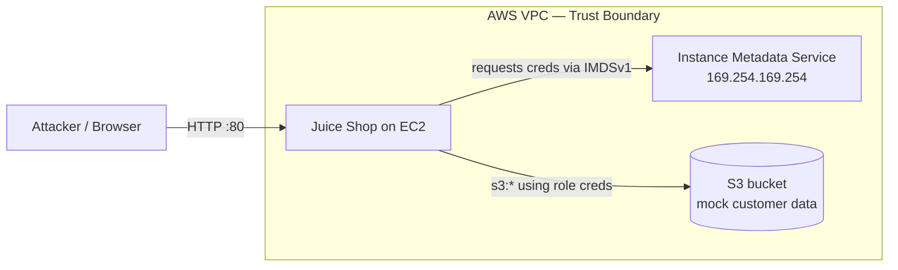

# Threat Model — Cloud Purple Team Lab

## System Overview
A single EC2 instance runs OWASP Juice Shop (a deliberately vulnerable
web app) in Docker. The instance has an IAM role and can reach an S3
bucket holding mock customer data. Only the author's IP can reach the app.

## Data Flow Diagram

The trust boundary is the VPC edge. Requests from the attacker cross it
at the app. The danger is that a web-layer bug lets the attacker reach
**inside** resources (IMDS, then S3) they should never touch.

## Trust Boundaries
1. **Internet → Juice Shop (port 80):** attacker-controlled input enters here.
2. **Juice Shop → IMDS (169.254.169.254):** should never be reachable by user input.
3. **EC2 role → S3:** the role can read every bucket (over-permissioned).

## STRIDE Analysis
| Threat | Example in this system | Planted weakness |
|---|---|---|
| **S**poofing | Weak/guessable login on Juice Shop | App-level |
| **T**ampering | Manipulating input to reach internal URLs (SSRF) | App-level |
| **R**epudiation | No logging of who did what | No CloudTrail/app logging yet (Phase 4) |
| **I**nfo disclosure | Stealing role credentials from IMDS | **VULN-2: IMDSv1 enabled** |
| **D**enial of service | Crashing/overloading the single instance | Out of scope for this lab |
| **E**levation of privilege | Using stolen creds to read all S3 data | **VULN-1: s3:\* on \*** |

## Primary Attack Path (to be executed in Phase 3)
1. Exploit a web bug (SSRF) in Juice Shop.
2. Use it to query IMDS at 169.254.169.254.
3. IMDSv1 returns the instance role's temporary credentials (**VULN-2**).
4. Use those credentials to list and download the S3 bucket (**VULN-1**).

This is the same class of attack as the 2019 Capital One breach.

## Key Risks Identified
- **Credential theft via IMDSv1** — highest priority; enables everything else.
- **Over-permissioned IAM role** — turns a foothold into full data access.
- **No detection** — nothing currently logs or alerts on any of this (fixed in Phase 4).